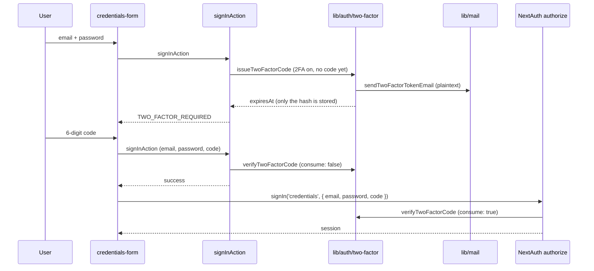

# Implementation Plan — `053-email-two-factor-auth`

> **Spec:** [`spec.md`](./spec.md)

## 1. High-Level Approach

Split the feature in two halves so the security-critical arithmetic is testable
without a database:

- `apps/web/lib/auth/two-factor-code.ts` — **pure**: code generation, hashing,
  constant-time digest comparison, expiry and lockout arithmetic. No `db`, no
  mail, no `next/headers` imports, so it can be imported directly by a test file
  without spinning up an app. It uses `node:crypto`, so it is Node-runtime code,
  as every caller already is.
- `apps/web/lib/auth/two-factor.ts` — **stateful**: reads and writes
  `twoFactorCodes` and the `client_profiles` 2FA columns, and dispatches the
  email.

The sign-in flow then gets a second leg. Two call sites verify, deliberately:

1. `signInAction` (server action) pre-checks so the user gets a *specific*,
   translatable message. NextAuth collapses everything `authorize` throws into a
   generic `CredentialsSignin`, which is why the existing password check is also
   duplicated there. This leg verifies with `consume: false`.
2. `authorize` in `lib/auth/credentials.ts` is the **authoritative** gate — it is
   the only place a session is minted, so a scripted
   `signIn('credentials', …)` that skips the server action still has to satisfy
   it. This leg consumes the code.

## 2. Architecture Diagram



## 3. Affected Packages & Files

| Area | File | Change |
| --- | --- | --- |
| DB | `apps/web/lib/db/schema.ts` | new `twoFactorCodes` table; `two_factor_failed_attempts` / `two_factor_locked_until` on `clientProfiles`; five `ActivityType` members |
| DB | `apps/web/lib/db/migrations/0042_email_two_factor_auth.sql` (+ `meta/`) | additive, idempotent migration (written as `0040`, renumbered `0042` on merge) |
| DB | `apps/web/lib/db/migrations/0044_reapply_email_two_factor_auth.sql` | re-runs 0042 where drizzle skipped it (T-2647, §8) |
| DB | `apps/web/lib/db/queries/client.queries.ts` | three `ClientProfileWithAuth` projections extended with the two new columns |
| Lib | `apps/web/lib/auth/two-factor-code.ts` | new — pure primitives |
| Lib | `apps/web/lib/auth/two-factor.ts` | new — stateful helpers |
| Lib | `apps/web/lib/auth/auth-error-codes.ts` | five `TWO_FACTOR_*` codes |
| Lib | `apps/web/lib/auth/credentials.ts` | `code` credential + authoritative gate |
| Mail | `apps/web/lib/mail/templates/two-factor-code.ts` | new branded template |
| Mail | `apps/web/lib/mail/index.ts` | `sendTwoFactorTokenEmail` uses it; optional third argument |
| API | `apps/web/app/api/auth/security/2fa/{enable,disable}/route.ts` | new |
| API | `apps/web/app/api/auth/2fa/resend/route.ts` | new |
| API | `apps/web/app/api/auth/security/settings/route.ts` | returns `canEnableTwoFactor`, `authMethod`, real `loginAttemptsCount` / `accountLocked` / `accountLockedUntil` |
| UI | `apps/web/components/settings/security/two-factor-card.tsx` | new |
| UI | `apps/web/components/settings/security/security-overview.tsx` | lock copy reflects a temporary, self-clearing lock |
| UI | `apps/web/app/[locale]/auth/components/credentials-form.tsx` | code step, resend, countdown, back |
| UI | `apps/web/app/[locale]/auth/actions.ts` | 2FA leg in `signInAction` |
| Hooks | `apps/web/hooks/use-security-settings.ts` | `useEnableTwoFactor` / `useDisableTwoFactor` |
| i18n | `apps/web/messages/*.json` (21) | `auth.TWO_FACTOR.*`, `settings.SECURITY_PAGE.TWO_FACTOR.*` |
| Config | `apps/web/.env.example` | four documented, optional env vars |
| Util | `apps/web/lib/utils/rate-limit.ts` | new `refundRateLimit()` (release one reserved slot) |
| API | `apps/web/app/api/auth/security/login-activity/route.ts` | 2FA audit events added to `SECURITY_ACTIONS` |
| UI | `apps/web/components/settings/security/login-history-card.tsx` | presentation for the three 2FA audit events |
| Tests | `apps/web-e2e/tests/unit/two-factor-code.spec.ts` | pure-function unit coverage |
| Tests | `apps/web-e2e/tests/auth/two-factor-login.spec.ts` | enable → challenge → disable, expiry, lockout |
| Tests | `apps/web-e2e/tests/api/auth-2fa-routes.spec.ts` | auth / OAuth / resend contract |
| Tests | `apps/web-e2e/helpers/two-factor-db.ts` | test-only DB access |

## 4. Data Model

```
twoFactorCodes
  id          text pk
  userId      text -> users.id  on delete cascade   (indexed)
  email       text
  code_hash   text      -- hex HMAC-SHA256 under a server key; NEVER the code
  expires     timestamp                              (indexed)
  attempts    integer default 0
  consumed_at timestamp
  created_at  timestamp default now()
  tenant_id   text -> tenant.id on delete cascade    (indexed)

client_profiles
  two_factor_enabled          boolean  (pre-existing, now written)
  two_factor_failed_attempts  integer default 0
  two_factor_locked_until     timestamp
```

Rotate-on-issue: minting a code deletes every earlier code for that user, so at
most one is live and the newest email is always the valid one — the same shape
`verificationTokens` and `passwordResetTokens` already use. Issuing also sweeps
rows that expired more than a day ago so the table cannot grow without bound.

## 5. Security Decisions

- **Hash-only storage, and the hash is KEYED.** `code_hash` is a hex
  HMAC-SHA256 under `TWO_FACTOR_CODE_SECRET` (falling back to `AUTH_SECRET`).
  A bare digest would not do: the code space is 10^6, so a rainbow table of
  every six-digit SHA-256 fits in a few megabytes and anyone with read access to
  the table could recover live codes. The key lives in the environment, not the
  database, so a dump alone yields nothing. A slow KDF would also close it but
  would put a deliberate cost on a sign-in hot path for a secret that already
  expires in ten minutes and tolerates only five guesses. Comparison is
  `crypto.timingSafeEqual` over the two digests, never `===`.
- **Where the budget lives.** The enforcement counter is on `client_profiles`,
  not on the code row, precisely so that requesting a resend cannot clear it.
- **No oracle while locked.** An active lockout short-circuits before the code
  table is touched, so a locked account leaks nothing about whether a code
  exists.
- **Malformed input is free.** A value that is not six digits cannot match a
  digest, so it does not spend an attempt — otherwise a clumsy user could lock
  themselves out with typos.
- **Enumeration.** `POST /api/auth/2fa/resend` answers `200` for every
  well-formed request regardless of whether the address exists, the password is
  right, or 2FA is on. The only distinguishable answer is `429`.
- **The resend route re-checks the password** because there is no session at that
  point in the flow; without it, anyone who knows an address could use the
  endpoint to bomb that inbox.
- **Issuance is capped inside `issueTwoFactorCode`** (6 per 10 minutes per
  account), not only at the routes. `authorize` is reachable by posting straight
  to `/api/auth/callback/credentials`, which skips the server action (until
  T-2839 it also skipped the per-email password budget, see below); putting the
  cap at the single choke point every issuance path shares closes that hole. On the sign-in paths, exceeding it answers
  `AuthErrorCode.RATE_LIMITED` and mints nothing; the resend route keeps its
  generic `200`. The count comes from the **database** (rows in the window), not
  from the in-memory `ratelimit()` map, because a process-local counter would
  let a multi-instance deployment issue `6 × instances` codes per window. That
  is why issuing marks earlier codes consumed rather than deleting them — a
  deleted row cannot be counted. Count-then-insert is a read-modify-write, so
  it runs inside a transaction that first takes a per-user
  `pg_advisory_xact_lock`; otherwise concurrent issues would all read the
  same under-limit count and all insert, and the cap would not hold at all.
- **The password budget is reserved, not checked-then-charged, and counts
  failed attempts.** The sign-in action calls `ratelimit()` up front for every
  submission (an atomic map read-and-write with no `await` inside) and hands
  the slot back with `refundRateLimit()` once the password has proven correct,
  on the admin and the client path, with or without a code. A wrong password
  or an unknown email keeps its slot, so 5 failed attempts in 15 minutes lock
  the email, while correct passwords never use the budget up (before T-2831
  only a code-carrying submission got its slot back, so the sixth correct
  sign-in in a window was refused). The refund passes the `resetTime` its
  reservation got, so a refund that arrives after that window ran out and a
  new one opened is dropped instead of erasing a failed attempt the new
  window counted. A check-then-act pair around the password
  verification would let concurrent requests all observe "slots remaining",
  which is exactly how a second factor turns into extra password guesses.
- **`authorize` spends the same password budget (T-2839).** The action only
  pre-checks the password; the browser then calls `signIn('credentials', …)`,
  which posts to `/api/auth/callback/credentials` and runs `authorize`. Until
  T-2839 nothing there touched the budget, so a script could take a CSRF token
  from `/api/auth/csrf` and post password guesses straight to the callback, for
  any account, admins included, with no limit. The limit, the window and the
  `signin:<email>` key builder now live in `lib/auth/signin-password-budget.ts`,
  imported by both. `authorize` reserves a slot on that key before any account
  lookup or password check, throws `RATE_LIMITED` once the budget is spent, and
  refunds the slot as soon as the password proves correct on the admin and the
  client path, so the normal flow (the action, then the callback) never counts a
  correct sign-in twice. The key is the email lowercased and trimmed, the way
  the account lookups normalize it, so a re-cased or padded spelling cannot open
  a fresh budget. The callback's email comes straight from the request body, so
  `authorize` first refuses one that is not a string or is longer than the 255
  characters `signInSchema` allows (`SIGN_IN_EMAIL_MAX_LENGTH`): the limiter
  keeps every key for its window, and an unbounded key let each request keep
  megabytes of memory alive for 15 minutes. The counter is still the in-memory
  `ratelimit()` map, so the
  bound is per server instance (see the spec's out-of-scope note).
- **One store for both legs (T-2844).** The bundler loads
  `lib/utils/rate-limit.ts` once per layer, so the server action and the route
  handler each get their own copy of the module (`next dev` with Turbopack
  lists it as `[app-rsc]` and `[app-route]`). While each copy kept its own map,
  each counted the key on its own: five wrong passwords through the form left
  the callback a full budget, so a script got five more guesses per window and
  the right password posted to the callback still got a session. The store now
  lives on `globalThis` under `Symbol.for('ever-works.rate-limit-state.v1')`
  (the way `lib/content.ts` keeps its caches), so every copy in the process
  reads and writes one map, and the cleanup interval starts once per process.
  The action now refuses with `RATE_LIMITED` once the callback has counted five
  failures, and the callback refuses once the action has. The action can still
  accept a correct password that the callback then refuses, when another guess
  takes the last slot between the two; the form shows `SESSION_REFRESH_FAILED`
  in that case and, since T-2839, sends one `signIn` per submission instead of
  retrying in a loop (spec 027).

## 6. Alternatives Considered

- **Redis for attempt tracking** (as the ticket suggests). Rejected: the template
  has no Redis dependency and adding one for this would be a deployment
  requirement for every generated directory. The database is already shared
  across pods, which is the property that actually matters.
- **A separate `/auth/verify` page** for the code step. Rejected: it would need
  to carry the password across a navigation. Keeping the step inside the existing
  form keeps the credentials in component state and out of any URL or cookie.
- **Storing a "2FA pending" marker in the JWT.** Rejected: it would mean issuing
  a token before the second factor passed. Nothing is minted until `authorize`
  returns.
- **bcrypt (or another slow KDF) for the code hash.** Rejected in favour of a
  keyed HMAC: it closes the same rainbow-table hole, but costs a KDF round on a
  login hot path for a secret that already expires in ten minutes and tolerates
  only five guesses. A *bare* SHA-256 was rejected outright — 10^6 candidates is
  not a search.
- **Requiring a verified email address before 2FA may be enabled.** Rejected for
  now: `client_profiles.email_verified` defaults to `false` and the sign-up flow
  never flips it, so the guard would refuse essentially every account on a
  default deployment. The lockout risk it addresses is instead handled by
  refusing to enable when no mail provider is configured at all (`503`
  `EMAIL_NOT_CONFIGURED`) — the case where a code could *never* arrive — plus
  the documented operator unlock. Recorded as Q-047b.

## 7. Constitution Check

| Article | Verdict |
| --- | --- |
| I — Plugin-first | Not applicable: this extends the core auth flow, which the constitution keeps outside packages. No plugin boundary is crossed. |
| II — TypeScript only | Pass. All new files are `.ts` / `.tsx`. |
| III — Public-surface stability | Pass. `sendTwoFactorTokenEmail`'s third argument is optional, so the previous two-argument call keeps working. `canEnableTwoFactor` / `authMethod` / `accountLockedUntil` are additive fields on the settings response, and the client types them optional. |
| IV — Latest stable frameworks | Pass. No dependency added or moved. |
| V — Performance budget | Pass. The card is a client component on an already-client settings page; the sign-in step adds no bundle beyond one input. The settings route adds two indexed queries. |
| VI — Reuse before build | Pass. Reuses `lib/mail`, `ratelimit()`, `logActivity`, the `hasPassword` detection from the connected-accounts route, and the `expires`-column pattern from `passwordResetTokens`. |
| VII — Test coverage | Pass. Unit coverage for the pure half, Playwright coverage for the flow and the routes. |
| VIII — No removal without migration | Pass. Purely additive; the pre-existing read-only 2FA badge keeps working and now reflects a value users can change. |
| IX — Documentation | Pass. This trio, [`docs/authentication/two-factor-auth.md`](../../authentication/two-factor-auth.md), a `docs/log.md` line and Q-047a. |
| X — Modular packages | Pass. Two focused modules, ~200 and ~170 lines. |

## 8. Rollout & Rollback

The migration is additive and idempotent (`CREATE TABLE IF NOT EXISTS`,
`ADD COLUMN IF NOT EXISTS`), so it can be applied ahead of the code and re-run
safely. No existing row changes meaning: `two_factor_enabled` stays `false`
everywhere until a user opts in, and every sign-in path for a user who has not
opted in is byte-identical to before.

**Skipped on databases that had run 0041 (T-2647).** The migration was renumbered
`0042` on merge but kept its `when` in `meta/_journal.json`, which was older than
`0041_billing_issue_refund_claim`. Drizzle's migrator runs only the entries whose
`when` is later than the newest row in `drizzle.__drizzle_migrations`, so every
database that had run 0041 skipped 0042 without an error: no `twoFactorCodes`
table and no brute-force columns. 0042's `when` now comes after 0041 (a database
whose newest row is 0041 runs it), and `0044_reapply_email_two_factor_auth`
re-runs 0042's statements, word for word and each a no-op where its object
exists, for databases that had already run 0043. Both are safe on a database that
did run 0042. `apps/web/lib/db/__tests__/migration-journal.spec.ts` fails on any
journal entry whose `when` is not later than the entries before it.

Rollback is to revert the application code; the added table and columns are inert
without it. Operators who need to unlock an account by hand can clear
`two_factor_failed_attempts` / `two_factor_locked_until`, or set
`two_factor_enabled = false`.
